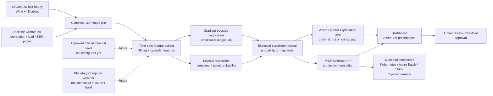

# TURNUP / MilestoSmiles — presentation results

## One-line pitch

TURNUP predicts when system-wide renewable curtailment is likely, then schedules flexible data-centre workloads into those windows without breaking deadlines, changing total workload energy or exceeding site capacity.

## Dataset used

- Hack the Climate `generation-load-prices.zip`: Irish generation, load and SEM price files.
- EirGrid System and Renewable Data Reports: DD half-hourly `Wind + IE` rows.
- Canonical joined dataset: **107,998** half-hourly intervals from 2020-01-01 to 2026-06-30.
- EirGrid-labelled overlap: **24,270** intervals, **22.47%** of canonical rows.
- Target: EirGrid `CURTAILMENTS_MWH`, kept separate from `CONSTRAINTS_MWH` and total dispatch-down.
- Planetary Computer weather data: **not used in this build**. It is a future feature source, not something we should claim was connected.
- Forecast columns in the historical files are empty, so the model result is a leakage-safe historical simulation, not a production day-ahead forecast.

## Model

- 36 past-only features: wind, load, price, renewable output and residual load at 1h, 3h, 6h, 24h, 48h and 7d lags, plus hour/day/month/weekend calendar features.
- Event model: balanced logistic regression, predicting whether curtailment exceeds 0.01 MWh.
- Magnitude model: histogram gradient-boosting regression, estimating the amount conditional on an event.
- Combined signal: `expected curtailment = event probability × conditional magnitude`.
- Resolution: one score per 30-minute interval; the dashboard schedules a 24-hour horizon (48 half-hour slots).
- Chronological split: 65% train, 15% validation, 20% held-out test.

### Held-out model results

| Metric | TURNUP model | Transparent heuristic |
|---|---:|---:|
| Test intervals | 4,778 | 4,778 |
| Curtailment events | 1,253 | 1,253 |
| Event rate | 26.22% | 26.22% |
| PR-AUC | **0.78523** | 0.70948 |
| Precision at 0.5 | **0.66506** | — |
| Recall at 0.5 | **0.77175** | — |
| Top-decile recall | **0.33998** | 0.30008 |
| Top-decile lift | **3.398×** | 2.999× |
| Brier score | **0.11725** | — |
| Magnitude MAE | **49.98 MWh** | — |

Forward monthly PR-AUC was 0.939 (March), 0.817 (April), 0.355 (May) and 0.772 (June). This variation is why monitoring and future operational validation remain important.

## Schedule evaluation

The workload portfolio is five flexible jobs requiring **38 MWh per day**, evaluated over **84 complete held-out days**.

| Policy | Curtailment overlap | Improvement vs fixed | Mean cost/day | Guardrails |
|---|---:|---:|---:|---|
| Fixed | 797.49 MWh | baseline | €4,214.01 | 0 deadline/capacity violations |
| Price-only | 1,015.58 MWh | +218.09 MWh | €3,667.50 | 0 deadline/capacity violations |
| TURNUP | **1,009.59 MWh** | **+212.10 MWh (+26.6%)** | €3,853.54 | 0 deadline/capacity violations |
| Oracle | 1,190.73 MWh | +393.24 MWh | €4,010.67 | 0 deadline/capacity violations |

The oracle sees actual future curtailment and is only an upper bound. Price-only was slightly higher than TURNUP on this historical slice, so the defensible claim is that TURNUP materially improves on fixed scheduling while approaching the oracle; it did not beat every baseline on every metric.

## Architecture diagram

## What is implemented versus pending

- Implemented: audited data join, historical model, model-to-optimiser signal, schedule comparison, SciPy MILP foundation, dashboard, monitoring scripts and dry-run connectors.
- Partly implemented: authenticated API exists but is not publicly exposed; Azure OpenAI configuration exists but the dashboard still uses deterministic explanations.
- Pending activation: approved forecast URL/token, actual site/grid node, real workload-platform credentials, production Key Vault permissions, TLS/API deployment and explicit approval for live dispatch.

## Safe presentation wording

> “TURNUP is a historical, leakage-safe prototype that predicts system-wide renewable-curtailment opportunities and moves flexible data-centre workloads into those intervals. On 84 held-out days, it improved curtailment overlap by 26.6% over a fixed schedule while preserving all workload energy, deadlines and site-capacity limits. The next step is replacing historical inputs with approved operational forecasts and connecting a real workload platform.”
